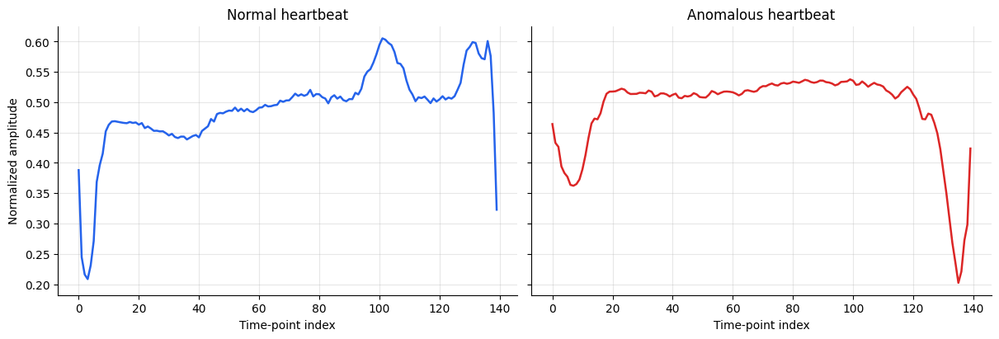
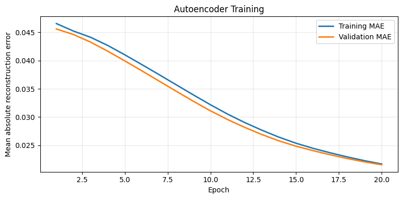
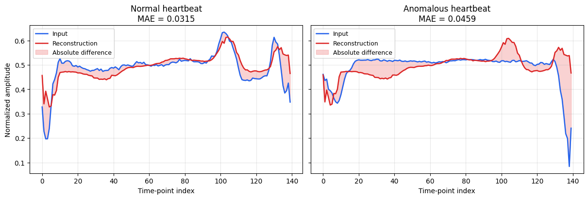
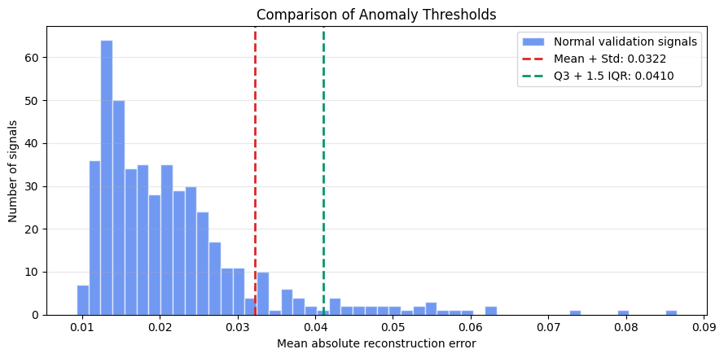
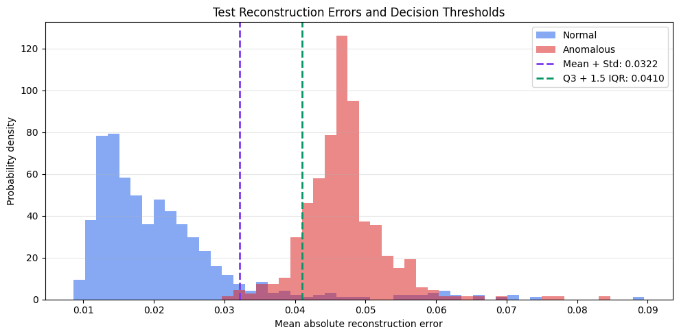
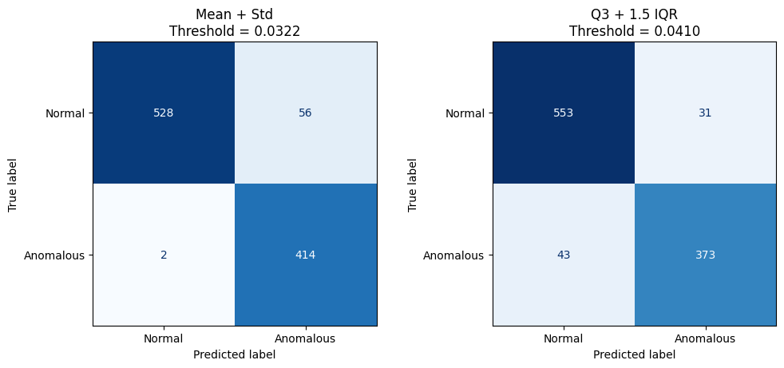

## Introduction

This project explores anomaly detection in electrocardiogram (ECG)
signals using an autoencoder and reconstruction error. The objective
is to investigate whether a model trained on normal signals can
identify patterns that differ from those observed during training.

Rather than learning a direct mapping from signals to class labels,
the autoencoder learns to reconstruct normal ECG patterns. The
reconstruction error is then used as an anomaly score: signals with
errors above a selected threshold are flagged as potentially anomalous.

The workflow covers data exploration, preprocessing, model training,
threshold selection, and performance evaluation. Available labels
are used to identify normal training samples and evaluate the
resulting anomaly predictions.

This project is an experimental machine learning study and is not
intended for clinical diagnosis.

### Imports

The following libraries support data manipulation, visualization,
model development, and performance evaluation.

```python
import matplotlib.pyplot as plt
import numpy as np
import pandas as pd
import tensorflow as tf

from sklearn.metrics import accuracy_score, precision_score, recall_score
from sklearn.model_selection import train_test_split
from tensorflow.keras import layers, losses
from tensorflow.keras.models import Model
```

## Dataset

This project uses a simplified, binary-labeled version of ECG5000,
distributed through the TensorFlow autoencoder tutorial. ECG5000
contains approximately 5,000 univariate heartbeat sequences, each
represented by 140 time points.

While the original dataset contains five heartbeat classes, the
CSV used here already provides binary labels: 1 for normal
heartbeats and 0 for anomalous heartbeats. Each row contains
140 signal measurements followed by its corresponding label.

The task is formulated as anomaly detection. Normal samples are
selected for autoencoder training, while both normal and anomalous
samples are included in the evaluation. Labels are used to identify
normal training samples and assess detection performance rather
than as reconstruction targets.

### Load Dataset

The dataset is loaded directly from the TensorFlow data repository.
Because the CSV does not contain a header row, header=None
ensures that the first sample is read as data.

```python
dataset_url = (
    "http://storage.googleapis.com/download.tensorflow.org/data/ecg.csv"
)

dataframe = pd.read_csv(dataset_url, header=None)
```

The last column contains the binary labels. The remaining columns
contain the ECG measurements.

```python
raw_data = dataframe.values
# The last column contains the labels: 1 = normal, 0 = anomalous.
labels = raw_data[:, -1]
# The remaining columns contain the ECG signal measurements.
signals = raw_data[:, :-1]
```

### Initial Data Inspection

Before preprocessing, the dataset dimensions, missing values,
and class distribution are inspected.

```python
print(f"Number of samples: {signals.shape[0]}")
print(f"Time points per signal: {signals.shape[1]}")
print(f"Missing values: {dataframe.isna().sum().sum()}")

class_counts = (
    pd.Series(labels, name="label")
    .value_counts()
    .sort_index()
    .rename(index={0: "Anomalous", 1: "Normal"})
)

print("\nClass distribution:")
print(class_counts.to_string())
```
Output:
```text
Number of samples: 4998
Time points per signal: 140
Missing values: 0

Class distribution:
label
Anomalous    2079
Normal       2919
```

### Train–Test Split

The signals are divided into training and test sets, using 80% of the
samples for training and 20% for testing. A fixed random seed makes
the split reproducible, while stratification approximately preserves
the proportion of normal and anomalous samples in both subsets.

The test set is reserved for the final performance evaluation.
Although the initial training partition contains both classes,
only normal samples are subsequently used to train the autoencoder.

```python
train_data, test_data, train_labels, test_labels = train_test_split(
    signals,
    labels,
    test_size=0.2,
    random_state=21,
    stratify=labels,
)

print(f"Training samples: {train_data.shape[0]}")
print(f"Test samples: {test_data.shape[0]}")
```
Output:
```text
Training samples: 3998
Test samples: 1000
```

### Signal Normalization

A global min–max transformation is applied using the minimum and
maximum values observed across all signals in the training partition.

These training-derived parameters map the training values to the
[0, 1] interval and are reused unchanged to transform the test set.
The transformation therefore does not use test-set statistics.

A single pair of scaling parameters is used for all signals, rather
than normalizing each heartbeat independently. Test values outside
the training range may consequently fall below 0 or above 1.

In this implementation, scaling parameters are estimated from the
full training partition, including both classes. Normal samples
are selected afterward for autoencoder training.

```python
# Estimate global scaling parameters from the training partition only.
min_val = float(np.min(train_data))
max_val = float(np.max(train_data))
scale_range = max_val - min_val

# Apply the same transformation to training and test signals.
train_data = tf.convert_to_tensor(
    (train_data - min_val) / scale_range,
    dtype=tf.float32,
)

test_data = tf.convert_to_tensor(
    (test_data - min_val) / scale_range,
    dtype=tf.float32,
)

print(f"Training minimum before scaling: {min_val:.4f}")
print(f"Training maximum before scaling: {max_val:.4f}")

print(
    "Normalized training range: "
    f"[{tf.reduce_min(train_data).numpy():.4f}, "
    f"{tf.reduce_max(train_data).numpy():.4f}]"
)

print(
    "Normalized test range: "
    f"[{tf.reduce_min(test_data).numpy():.4f}, "
    f"{tf.reduce_max(test_data).numpy():.4f}]"
)
```
Output:
```text
Training minimum before scaling: -7.0904
Training maximum before scaling: 7.4021
Normalized training range: [0.0000, 1.0000]
Normalized test range: [0.0559, 0.8319]
```

### Selecting Normal Training Samples

Normal heartbeats are labeled as 1, while anomalous heartbeats
are labeled as 0. Boolean masks are used to separate the classes
within each partition.

Only normal training signals are used to optimize the autoencoder.
The test signals from both classes are retained to evaluate whether
reconstruction error can distinguish normal from anomalous patterns.

```python
normal_train_mask = train_labels == 1
normal_test_mask = test_labels == 1

normal_train_data = tf.boolean_mask(train_data, normal_train_mask)
anomalous_train_data = tf.boolean_mask(train_data, ~normal_train_mask)

normal_test_data = tf.boolean_mask(test_data, normal_test_mask)
anomalous_test_data = tf.boolean_mask(test_data, ~normal_test_mask)

print(f"Normal training samples: {normal_train_data.shape[0]}")
print(f"Anomalous training samples: {anomalous_train_data.shape[0]}")
print(f"Normal test samples: {normal_test_data.shape[0]}")
print(f"Anomalous test samples: {anomalous_test_data.shape[0]}")
```
Output:
```text
Normal training samples: 2335
Anomalous training samples: 1663
Normal test samples: 584
Anomalous test samples: 416
```

### Normal and Anomalous ECG Examples

One normal and one anomalous training signal are shown below.
Both panels use the same axis limits to support a direct visual
comparison of waveform shape and normalized amplitude.

These are individual examples and should not be interpreted as
representative of every signal within their respective classes.

```python
time_points = np.arange(train_data.shape[1])

fig, axes = plt.subplots(
    nrows=1,
    ncols=2,
    figsize=(12, 4),
    sharex=True,
    sharey=True,
    constrained_layout=True,
)

examples = [
    (normal_train_data[0].numpy(), "Normal heartbeat", "#2563EB"),
    (anomalous_train_data[0].numpy(), "Anomalous heartbeat", "#DC2626"),
]

for ax, (signal, title, color) in zip(axes, examples):
    ax.plot(time_points, signal, color=color, linewidth=1.8)
    ax.set_title(title)
    ax.set_xlabel("Time-point index")
    ax.grid(True, alpha=0.3)
    ax.spines["top"].set_visible(False)
    ax.spines["right"].set_visible(False)

axes[0].set_ylabel("Normalized amplitude")

plt.show()
```


These individual examples illustrate waveform differences, but do not
represent the full variability within each class.

## Building the Model

A fully connected autoencoder is used to learn a compact representation
of normal ECG signals. The encoder progressively reduces each
140-point sequence to an eight-dimensional latent representation,
while the decoder reconstructs the signal from this representation.

The encoder uses dense layers with 32, 16, and 8 units. The decoder
mirrors this expansion with 16 and 32 units, followed by an output
layer with 140 units. Hidden layers use ReLU activation, while the
output layer uses a sigmoid activation to produce values between
0 and 1.

The model is optimized using Adam and mean absolute error (MAE),
which measures the average absolute difference between each input
signal and its reconstruction.

```python
class AnomalyDetector(Model):
    def __init__(self):
        super().__init__()

        self.encoder = tf.keras.Sequential([
            layers.Input(shape=(140,)),
            layers.Dense(32, activation="relu"),
            layers.Dense(16, activation="relu"),
            layers.Dense(8, activation="relu"),
        ])

        self.decoder = tf.keras.Sequential([
            layers.Input(shape=(8,)),
            layers.Dense(16, activation="relu"),
            layers.Dense(32, activation="relu"),
            layers.Dense(140, activation="sigmoid"),
        ])

    def call(self, inputs, training=False):
        encoded = self.encoder(inputs, training=training)
        return self.decoder(encoded, training=training)


tf.keras.utils.set_random_seed(21)

autoencoder = AnomalyDetector()
autoencoder.compile(optimizer="adam", loss="mae")
```

## Train the Autoencoder

Only normal ECG signals are used to train the autoencoder. Each
signal serves as both the input and the reconstruction target.

The normal training samples are further divided into fitting and
validation subsets. The validation subset monitors reconstruction
performance on normal signals not used for gradient updates,
while the test set remains reserved for subsequent evaluation.

The model is trained for 20 epochs with a batch size of 512.
Training samples are shuffled between epochs.

```python
normal_fit_data, normal_val_data = train_test_split(
    normal_train_data.numpy(),
    test_size=0.2,
    random_state=21,
)

history = autoencoder.fit(
    normal_fit_data,
    normal_fit_data,
    epochs=20,
    batch_size=512,
    validation_data=(normal_val_data, normal_val_data),
    shuffle=True,
    verbose=1,
)
```

### Training and Validation Loss

Training and validation MAE are tracked across epochs to inspect
optimization progress and the difference between fitting and
held-out reconstruction performance.

Both curves describe reconstruction of normal signals. They do not,
by themselves, measure anomaly detection performance.

```python
epochs = np.arange(1, len(history.history["loss"]) + 1)

fig, ax = plt.subplots(figsize=(8, 4))

ax.plot(
    epochs,
    history.history["loss"],
    label="Training MAE",
    linewidth=2,
)

ax.plot(
    epochs,
    history.history["val_loss"],
    label="Validation MAE",
    linewidth=2,
)

ax.set_xlabel("Epoch")
ax.set_ylabel("Mean absolute reconstruction error")
ax.set_title("Autoencoder Training")
ax.grid(True, alpha=0.3)
ax.legend()

fig.tight_layout()
plt.show()
```


## Inspecting Signal Reconstructions

The trained autoencoder is applied to one normal and one anomalous
signal from the test set. Each panel compares the original waveform
with its reconstruction.

The shaded region highlights pointwise differences between the
signals. The reported MAE summarizes these differences as a single
reconstruction-error value for each example.

These examples provide a qualitative inspection; conclusions about
anomaly detection require evaluating the full test set.

```python
# Select one signal from each class.
normal_example = normal_test_data[0].numpy()
anomalous_example = anomalous_test_data[0].numpy()

# Stack the two signals into a batch.
examples = np.stack([normal_example, anomalous_example])

reconstructions = autoencoder.predict(examples, verbose=0)
errors = np.mean(np.abs(examples - reconstructions), axis=1)

time_points = np.arange(examples.shape[1])

fig, axes = plt.subplots(
    1, 2,
    figsize=(12, 4),
    sharex=True,
    sharey=True,
    constrained_layout=True,
)

titles = ["Normal heartbeat", "Anomalous heartbeat"]

for i, ax in enumerate(axes):
    ax.plot(
        time_points,
        examples[i],
        color="#2563EB",
        label="Input",
        linewidth=1.8,
    )

    ax.plot(
        time_points,
        reconstructions[i],
        color="#DC2626",
        label="Reconstruction",
        linewidth=1.8,
    )

    ax.fill_between(
        time_points,
        examples[i],
        reconstructions[i],
        color="lightcoral",
        alpha=0.35,
        label="Absolute difference",
    )

    ax.set_title(f"{titles[i]}\nMAE = {errors[i]:.4f}")
    ax.set_xlabel("Time-point index")
    ax.grid(True, alpha=0.3)
    ax.legend(fontsize=9)

axes[0].set_ylabel("Normalized amplitude")

plt.show()
```


## Detect Anomalies

Reconstruction error is used as an anomaly score. For each ECG signal, the mean absolute error (MAE) is calculated between its input values and the corresponding reconstruction.

Two thresholds are estimated from normal validation errors:

- Mean + Std: the mean plus one standard deviation.
- Q3 + 1.5 IQR: the third quartile plus 1.5 times the interquartile range.

A signal is classified as anomalous when its reconstruction error exceeds the selected threshold. All thresholds are fixed before
test-set evaluation.

### Calculate Errors and Thresholds

Validation and test reconstruction errors are computed once and reused throughout the analysis. Only normal validation errors are
used to estimate the thresholds.

```python
def reconstruction_mae(model, data):
    inputs = np.asarray(data, dtype=np.float32)
    reconstructions = model.predict(inputs, verbose=0)
    return np.mean(np.abs(inputs - reconstructions), axis=1)


val_errors = reconstruction_mae(autoencoder, normal_val_data)
test_errors = reconstruction_mae(autoencoder, test_data)

q1, q3 = np.percentile(val_errors, [25,75])
iqr = q3 - q1

thresholds = {
    "Mean + Std": float(
        np.mean(val_errors) + np.std(val_errors, ddof=0)
    ),
    "Q3 + 1.5 IQR": float(q3 + 1.5 * iqr),
}

threshold_colors = {
    "Mean + Std": "#7C3AED",
    "Q3 + 1.5 IQR": "#059669",
}

# Original dataset convention: 1 = normal, 0 = anomalous.
original_labels = np.asarray(test_labels).astype(int).ravel()

normal_mask = original_labels == 1
anomalous_mask = original_labels == 0

# Evaluation convention: 1 = anomalous, 0 = normal.
y_true = anomalous_mask.astype(int)

for name, value in thresholds.items():
    print(f"{name}: {value:.6f}")
```
Output:
```text
Mean + Std: 0.032187
Q3 + 1.5 IQR: 0.040990
```

### Threshold Estimation

The histogram shows reconstruction errors for normal validation signals. Dashed lines indicate the two decision thresholds.

Normal signals above a threshold would be flagged as anomalous.

```python
def add_threshold_lines(ax):
    for name, value in thresholds.items():
        ax.axvline(
            value,
            color=threshold_colors[name],
            linestyle="--",
            linewidth=2,
            label=f"{name}: {value:.4f}",
        )


fig, ax = plt.subplots(figsize=(9, 4.5))

ax.hist(
    val_errors,
    bins=50,
    color="#2563EB",
    alpha=0.65,
    edgecolor="white",
    label="Normal validation signals",
)

add_threshold_lines(ax)

ax.set_xlabel("Mean absolute reconstruction error")
ax.set_ylabel("Number of signals")
ax.set_title("Threshold Estimation on Normal Validation Signals")
ax.grid(axis="y", alpha=0.3)
ax.legend()

fig.tight_layout()
plt.show()
```



## Test Reconstruction Errors

Normal and anomalous test reconstruction errors are compared using shared histogram bins. Each class distribution is normalized to support comparison despite different sample counts.

The two thresholds are applied without further adjustment.
Normal signals above a threshold produce false positives, while anomalous signals at or below it produce false negatives.

```python
bins = np.histogram_bin_edges(test_errors, bins=50)

fig, ax = plt.subplots(figsize=(10, 5))

for mask, label, color in [
    (normal_mask, "Normal", "#2563EB"),
    (anomalous_mask, "Anomalous", "#DC2626"),
]:
    ax.hist(
        test_errors[mask],
        bins=bins,
        density=True,
        alpha=0.55,
        color=color,
        label=label,
    )

add_threshold_lines(ax)

ax.set_xlabel("Mean absolute reconstruction error")
ax.set_ylabel("Probability density")
ax.set_title("Test Reconstruction Errors and Decision Thresholds")
ax.grid(axis="y", alpha=0.3)
ax.legend()

fig.tight_layout()
plt.show()
```



## Anomaly Detection Performance

Both rules are evaluated on the same test signals, with anomalies treated as the positive class.

Accuracy measures overall correctness. Precision measures the proportion of predicted anomalies that are actually anomalous, while recall measures the proportion of actual anomalies detected.
F1-score summarizes the balance between precision and recall.

False-positive and false-negative counts are also reported to show the consequences of each decision rule.

```python
from sklearn.metrics import (
    accuracy_score,
    precision_score,
    recall_score,
    f1_score,
    confusion_matrix,
    ConfusionMatrixDisplay,
)

results = []
matrices = {}

for name, value in thresholds.items():
    y_pred = (test_errors > value).astype(int)

    matrix = confusion_matrix(
        y_true,
        y_pred,
        labels=[0,1]
    )
    matrices[name] = matrix

    tn, fp, fn, tp = matrix.ravel()

    results.append({
        "Method": name,
        "Threshold": value,
        "Accuracy": accuracy_score(y_true, y_pred),
        "Precision": precision_score(
            y_true, y_pred, zero_division=0
        ),
        "Recall": recall_score(
            y_true, y_pred, zero_division=0
        ),
        "F1": f1_score(
            y_true, y_pred, zero_division=0
        ),
        "False positive rate": (
            fp / (fp + tn) if (fp + tn) else np.nan
        ),
        "False positives": int(fp),
        "False negatives": int(fn),
    })

results_df = pd.DataFrame(results).set_index("Method")

print(results_df.round(4).to_string())
```
Output:
```text
              Threshold  Accuracy  Precision  Recall      F1  False positive rate  False positives  False negatives
Method                                                                                                             
Mean + Std       0.0322     0.942     0.8809  0.9952  0.9345               0.0959               56                2
Q3 + 1.5 IQR     0.0410     0.926     0.9233  0.8966  0.9098               0.0531               31               43
```

### Confusion Matrices

The confusion matrices show how each threshold affects normal and anomalous signals. Rows represent the true classes, and columns represent the predicted classes.

The top-right cell counts normal signals incorrectly flagged as anomalous. The bottom-left cell counts anomalies incorrectly
classified as normal. All panels use the same color scale.

```python
common_max = max(matrix.max() for matrix in matrices.values())
n_methods = len(matrices)

fig, axes = plt.subplots(
    nrows=1,
    ncols=n_methods,
    figsize=(5 * n_methods, 4.5),
    constrained_layout=True,
    squeeze=False,
)

for ax, (name, matrix) in zip(axes.ravel(), matrices.items()):
    display = ConfusionMatrixDisplay(
        confusion_matrix=matrix,
        display_labels=["Normal", "Anomalous"],
    )

    display.plot(
        ax=ax,
        cmap="Blues",
        colorbar=False,
        values_format="d",
        im_kw={"vmin": 0, "vmax": common_max},
    )

    ax.set_title(
        f"{name}\nThreshold = {thresholds[name]:.4f}"
    )

plt.show()
```


## Discussion

The two threshold-selection rules produced different trade-offs between anomaly detection and false alarms. The Mean + Std threshold achieved a recall of 99.52%, missing only 2 of the 416 anomalous test signals. However, it also incorrectly flagged 56 normal signals, corresponding to a false-positive rate of 9.59%.

The Q3 + 1.5 IQR threshold reduced false positives from 56 to 31, lowering the false-positive rate to 5.31%. This improvement came at the cost of reduced anomaly recall, which fell to 89.66%, with 43 anomalous signals incorrectly classified as normal.

Precision increased from 88.09% with Mean + Std to 92.33% with Q3 + 1.5 IQR, indicating that a larger proportion of its anomaly predictions were correct. Nevertheless, Mean + Std achieved a higher F1-score, 0.9345 compared with 0.9098, and higher overall accuracy, 94.20% compared with 92.60%.

These results illustrate that threshold selection is an important part of a reconstruction-based anomaly detection system. The trained autoencoder and reconstruction errors remained fixed; only the decision threshold changed.

For this test set, Mean + Std favored sensitivity to anomalies, whereas Q3 + 1.5 IQR favored fewer false alarms. The preferred trade-off would depend on the relative consequences of missed anomalies and unnecessary alerts, rather than on a single metric.

Both rules were evaluated on the same test set. Any subsequent selection or adjustment based on these results should be treated as model selection and assessed using an independent evaluation.

## Conclusion

This project implemented an autoencoder-based workflow for anomaly detection in ECG signals, covering data inspection, preprocessing, model training, reconstruction analysis, and threshold evaluation.

The results show that reconstruction error can distinguish normal and anomalous signals in this experimental setting, but the choice of threshold substantially affects the resulting predictions.
Mean + Std detected more anomalies and achieved a higher F1-score, while Q3 + 1.5 IQR produced fewer false alarms and higher precision.

The main finding is that anomaly detection performance depends not only on the reconstruction model, but also on how reconstruction errors are converted into decisions. Reporting false positives and false negatives alongside aggregate metrics makes this trade-off explicit.

These findings are limited to the dataset and evaluation procedure used here and do not establish clinical applicability. Future work could use stricter separation of preprocessing, model validation, and threshold calibration, followed by evaluation on independent
data.
