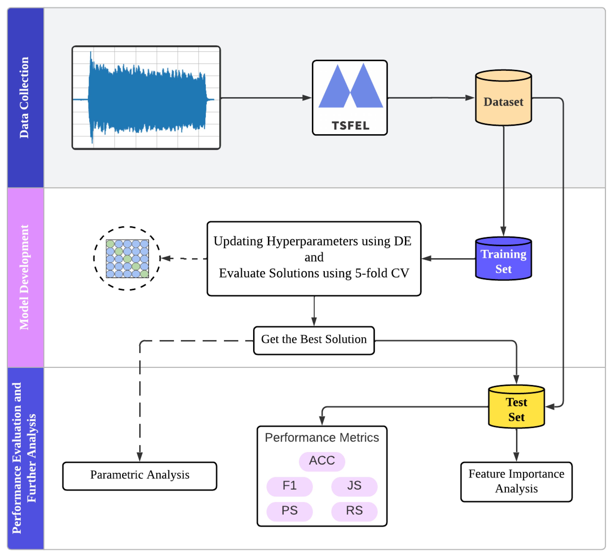
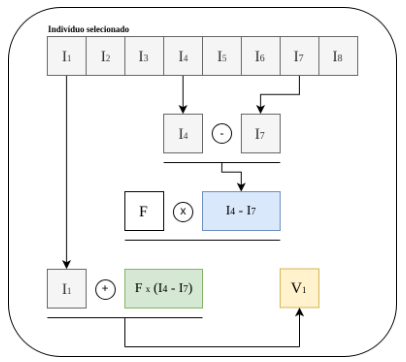
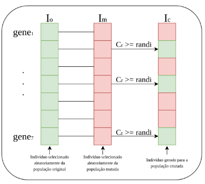
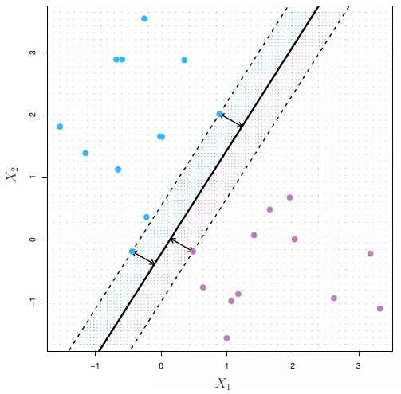
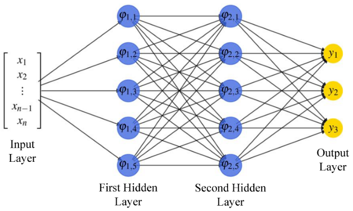

## Overview

This project investigates the classification of singing registers using acoustic features and supervised machine learning. The task is to distinguish chest, mixed, and head voice from audio recordings collected under controlled conditions.

The workflow combines time-domain feature extraction, evolutionary hyperparameter optimization, and repeated model evaluation. Rather
than learning directly from raw audio waveforms, the classifiers use a compact representation consisting of 14 acoustic features.

This case study presents a comparative workflow using support vector machines, multilayer perceptrons, and XGBoost. Differential evolution is used to search for model-specific hyperparameters, with candidate configurations evaluated through cross-validation within the training data.

## Associated Publication

This project is associated with the following peer-reviewed article:

Boratto, T., et al. (2025). Machine Learning with Evolutionary Parameter Tuning for Singing Registers Classification. Signals, 6(1), 9.

[Read the article](https://doi.org/10.3390/signals6010009)

The published study evaluates three model families and includes performance comparisons, hyperparameter analysis, and SHAP-based feature interpretation.

The best-performing model in the published study was XGBoost optimized with differential evolution, which achieved a mean classification accuracy of 97.60%.

## Data Availability

The underlying audio recordings and feature tables are not distributed with this portfolio. This page documents the methodology and selected results without providing the dataset.

Code examples illustrate the computational workflow, but reproducing the original experiments requires access to the corresponding data.

## Background

Human voice production involves an interaction between airflow, vocal-fold vibration, and vocal-tract filtering:

1. The respiratory system supplies airflow and the pressure required for phonation.
2. The vocal folds generate the sound source by modulating airflow through vibration.
3. The vocal tract shapes the resulting sound through its acoustic resonances.

Changes in vocal-fold configuration and vocal-tract shape influence the acoustic properties of the voice. These changes motivate the investigation of signal-derived features for distinguishing singing registers.

In this study, the classification task concerns three registers: chest voice, mixed voice, and head voice. The objective is to investigate whether temporal descriptors extracted from recordings provide useful information for distinguishing these categories.

## Dataset

### Audio Acquisition

The dataset contains 350 recordings produced by one experienced singer performing three singing registers under controlled recording conditions.

Each recording contains a sustained vowel /a/ lasting six seconds. Audio files were stored in WAV format at a sampling frequency of 44.1 kHz.

The acquisition setup included an Audio-Technica AT2020 cardioid microphone positioned approximately 10 cm from the singer's face, a Behringer Xenyx Q1202USB mixer, and REAPER recording software.

### Class Distribution

| Register | Class | Number of recordings |
|---|---|---:|
| Chest voice | Register 1 | 104 |
| Mixed voice | Register 2 | 110 |
| Head voice | Register 3 | 136 |
| Total | — | 350 |

All recordings were produced by the same singer. The evaluation therefore concerns register classification within this recording dataset.

### Acoustic Feature Extraction

Each recording was represented by 14 time-domain descriptors extracted using the Time Series Feature Extraction Library (TSFEL).

These descriptors summarize properties of the waveform, including its variation, turning points, differences between successive samples, and zero-crossing behavior.

The resulting dataset contains 350 observations and 14 input features, with one singing-register label assigned to each recording.

| Feature | Description |
|---|---|
| X1 | Area under the signal waveform |
| X2 | Signal autocorrelation |
| X3 | Temporal centroid |
| X4 | Mean absolute difference between successive samples |
| X5 | Mean difference between successive samples |
| X6 | Median absolute difference between successive samples |
| X7 | Median difference between successive samples |
| X8 | Number of negative turning points |
| X9 | Number of peaks within a defined signal neighborhood |
| X10 | Number of positive turning points |
| X11 | Distance traveled by the signal |
| X12 | Signal slope |
| X13 | Sum of absolute differences between successive samples |
| X14 | Zero-crossing rate |

This feature-based representation allows conventional machine learning models to operate on a compact tabular dataset rather than directly processing the full audio waveforms.

## Methodology

The computational workflow consists of three main stages: dataset construction, model development, and performance evaluation.

### 1. Dataset Construction

- Record audio samples for the three singing registers.
- Extract 14 temporal features from each recording using TSFEL.
- Assemble the feature matrix and corresponding class labels.

### 2. Model Development

- Randomly divide the dataset into training and test subsets, using 70% and 30% of the recordings, respectively.
- Use differential evolution to search for model hyperparameters.
- Evaluate candidate configurations using five-fold cross-validation within the training subset.
- Select the configuration with the best cross-validation score.
- Refit the selected model on the training subset.

The code excerpts below use mean weighted F1-score across five stratified cross-validation folds to evaluate candidate hyperparameter configurations.

### 3. Performance Evaluation

- Evaluate the selected model on the corresponding test subset.
- Repeat the optimization and evaluation process across 50 runs using different random seeds.
- Summarize classification performance across runs.
- Examine confusion patterns and selected hyperparameters.

The repeated test subsets are generated from the same underlying dataset and can overlap. These runs therefore assess variability across random partitions rather than performance on 50 independent external datasets.




## Theoretical Background

### Differential Evolution

Differential evolution (DE) is a population-based optimization algorithm. In this project, each candidate solution represents a possible set of classifier hyperparameters.

The search proceeds through four main operations:

1. Initialization: generate an initial population of candidate hyperparameter configurations.
2. Mutation: generate new candidate vectors using scaled differences between existing population members.
3. Crossover: combine information from a target vector and a mutant vector to produce a trial configuration.
4. Selection: compare the trial configuration with its target and retain the better-performing candidate.





For the SVM implementation, candidate configurations encode the kernel type, the kernel coefficient gamma, and the regularization parameter C.

Candidate configurations are evaluated through cross-validation within the training data. The optimization minimizes the negative mean weighted F1-score, while the test partition remains separate
from the search.

### Support Vector Machines

A support vector classifier learns decision boundaries by balancing
margin maximization against penalties for classification errors.

Kernel functions allow the model to represent nonlinear boundaries.
The choice of kernel and its associated hyperparameters can
substantially affect predictive performance.

In this project, differential evolution searches over linear,
radial basis function, and sigmoid kernels, together with the
regularization parameter C and kernel coefficient gamma.
Gamma affects the RBF and sigmoid kernels but is not used
by the linear kernel.



### Multilayer Perceptron

A multilayer perceptron is a feed-forward neural network consisting of an input layer, one or more hidden layers, and an output layer.

Hidden layers combine weighted inputs with activation functions to learn nonlinear relationships. During training, backpropagation computes gradients used by the optimizer to update the network parameters.

The published study explores architectural and training choices, including the number of hidden layers, neurons, activation functions, regularization, and optimization algorithm.



### Extreme Gradient Boosting

XGBoost is a gradient-boosted decision-tree method that constructs an additive ensemble of trees.

At each boosting stage, an additional tree is fitted using
information derived from the current objective function to
improve the ensemble's predictions. A learning rate controls
the contribution of each new tree, while regularization
helps control model complexity.

The published study optimizes the learning rate, number of
estimators, and regularization parameters using differential
evolution.

## Implementation

The following code excerpts illustrate the main components of the computational workflow: hyperparameter search spaces, evolutionary
optimization, and repeated evaluation.

Library imports, dataset loading, and the model-construction helper are omitted for brevity. The underlying recordings and feature tables are not distributed with this portfolio.


### Hyperparameter Search Spaces

Each model has its own hyperparameter representation. Integer and categorical choices are decoded from the candidate vectors proposed by differential evolution.

The search covers kernel settings for SVM, architecture and training settings for MLP, and regularization and boosting settings for XGBoost.

The excerpts assume that `X` contains the numerical feature matrix and `y` contains the corresponding class labels, encoded as consecutive integers starting at zero.

```python
KERNELS = ["linear", "rbf", "sigmoid"]
ACTIVATIONS = ["identity", "logistic", "tanh", "relu"]
SOLVERS = ["adam", "lbfgs", "sgd"]

SEARCH_SPACES = {
    # kernel index, gamma, C
    "SVM": [
        (0, 2),
        (1e-5, 1e3),
        (1, 10000),
    ],

    # alpha, hidden layers, neurons per layer, activation, solver
    "MLP": [
        (1e-4, 1),
        (1, 3),
        (1, 50),
        (0, 3),
        (0, 2),
    ],

    # L1 regularization, L2 regularization, learning rate, estimators
    "XGBoost": [
        (0, 1),
        (0, 1),
        (1e-6, 1),
        (10, 300),
    ],
}
```

### Evolutionary Hyperparameter Optimization

Candidate configurations are evaluated using five-fold stratified cross-validation within the training partition.

Weighted F1 is used as the optimization objective. Because differential evolution minimizes its objective, the function returns the negative cross-validation score.

The test partition is not used to guide the search.

```python
def optimize_model(name, X_train, y_train, seed):
    bounds = SEARCH_SPACES[name]

    cv = StratifiedKFold(
        n_splits=5,
        shuffle=True,
        random_state=seed,
    )

    def objective(parameters):
        model = build_model(name, parameters, seed)

        scores = cross_val_score(
            model,
            X_train,
            y_train,
            cv=cv,
            scoring="f1_weighted",
            n_jobs=-1,
            error_score="raise",
        )

        return -float(np.mean(scores))

    rng = np.random.default_rng(seed)

    lower = np.array(
        [bound[0] for bound in bounds],
        dtype=float,
    )

    upper = np.array(
        [bound[1] for bound in bounds],
        dtype=float,
    )

    initial_population = rng.uniform(
        lower,
        upper,
        size=(20, len(bounds)),
    )

    result = differential_evolution(
        objective,
        bounds=bounds,
        strategy="best1bin",
        init=initial_population,
        maxiter=30,
        mutation=0.8,
        recombination=0.9,
        tol=1e-5,
        polish=False,
        seed=seed,
    )

    best_model = build_model(name, result.x, seed)
    best_model.fit(X_train, y_train)

    return best_model, result
```

### Repeated Evaluation

Within each run, all three models use the same training and test partition. Each classifier is optimized independently on the training data and evaluated on the corresponding test subset.

The implementation stores test metrics, optimization scores, selected parameter vectors, and confusion matrices. Repeated partitions can overlap, so the runs should not be interpreted
as independent external datasets.

```python
def run_experiments(X, y, n_runs=50):
    records = []
    artifacts = {}
    class_labels = np.arange(len(np.unique(y)))

    for run in range(n_runs):
        seed = run + 10

        X_train, X_test, y_train, y_test = train_test_split(
            X,
            y,
            test_size=0.3,
            stratify=y,
            random_state=seed,
        )

        for name in SEARCH_SPACES:
            model, search = optimize_model(
                name, X_train, y_train, seed
            )

            predictions = model.predict(X_test)

            records.append({
                "Run": run + 1,
                "Model": name,
                "CV weighted F1": -search.fun,
                "Accuracy": accuracy_score(y_test, predictions),
                "Precision": precision_score(
                    y_test, predictions,
                    average="weighted",
                    zero_division=0,
                ),
                "Recall": recall_score(
                    y_test, predictions,
                    average="weighted",
                    zero_division=0,
                ),
                "F1": f1_score(
                    y_test, predictions,
                    average="weighted",
                    zero_division=0,
                ),
                "Jaccard": jaccard_score(
                    y_test, predictions,
                    average="weighted",
                    zero_division=0,
                ),
            })

            artifacts[(run + 1, name)] = {
                "parameters": search.x.copy(),
                "confusion_matrix": confusion_matrix(
                    y_test,
                    predictions,
                    labels=class_labels,
                ),
                "optimizer_success": bool(search.success),
                "optimizer_message": str(search.message),
            }

    return pd.DataFrame(records), artifacts
```

## Published Results

The results summarized in this section are reported in the associated peer-reviewed article.

The study compares SVC, MLP, and XGBoost with differential-evolution hyperparameter optimization. XGBoost achieved the highest reported mean classification accuracy, 97.60%, compared with 87.20% for SVC.

The published results indicate that a compact representation of 14 temporal features can support accurate register classification within the controlled dataset. They do not establish equivalent
performance for other singers or recording conditions.

## Discussion

### Feature-Based Classification

The study approaches audio classification as a tabular machine learning problem. Instead of training a model directly on complete waveforms, each recording is summarized by 14 temporal descriptors.

This representation provides a compact input for comparing kernel methods, neural networks, and gradient-boosted trees within a shared classification task.

### Model Comparison

XGBoost achieved the highest reported mean accuracy in the published experiments. This finding supports its suitability for the particular feature representation and controlled dataset used in the study.

It does not establish that XGBoost is universally superior for singing-register classification. Model rankings can depend on the dataset, preprocessing, search spaces, optimization budget, and evaluation protocol.

### Hyperparameter Optimization

Differential evolution provides a common mechanism for searching model-specific configurations. Candidate solutions are assessed through cross-validation rather than test-set performance.

However, the reported comparison does not, by itself, isolate the benefit of differential evolution over default parameters, random search, or other optimization methods. Establishing that
benefit would require a controlled comparison with matched evaluation budgets.

### Practical Interpretation

The results demonstrate the potential of combining engineered audio features with conventional classifiers in a controlled research setting.

A practical system would require additional evaluation across singers, sessions, microphones, and background conditions before its performance could be generalized beyond the original dataset.

## Limitations and Reproducibility

### Dataset Scope

The dataset contains recordings from one experienced singer. Random recording-level splits therefore assess performance within this dataset, not generalization to previously unseen singers.

The acquisition procedure also used controlled recording conditions and a sustained vowel. Performance on continuous singing, different vowels, or uncontrolled audio remains unverified.

### Repeated Partitions

The repeated experiments reuse the same underlying recordings. Test subsets may overlap across runs, so the resulting metrics must not be treated as measurements from independent external datasets.

### Data Availability

The recordings and feature tables are not distributed with this portfolio. Independent reproduction of the original numerical results is therefore not possible from this page alone.

## Conclusion

This project presents a feature-based workflow for singing-register classification, combining acoustic descriptors, evolutionary hyperparameter optimization, and comparative machine learning.

The associated publication evaluated SVC, MLP, and XGBoost, with XGBoost achieving the highest reported mean accuracy of 97.60% within the controlled dataset.

Beyond the application domain, the project demonstrates a workflow for transforming signals into tabular features, defining model-specific search spaces, separating hyperparameter selection
from test evaluation, and interpreting comparative results.

The findings support further investigation rather than deployment claims. Extending the dataset to multiple singers and recording conditions would be a necessary next step toward evaluating broader applicability.